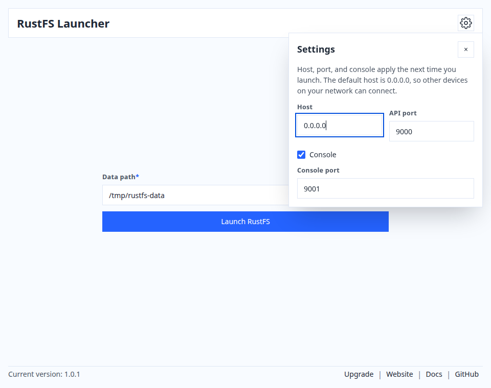
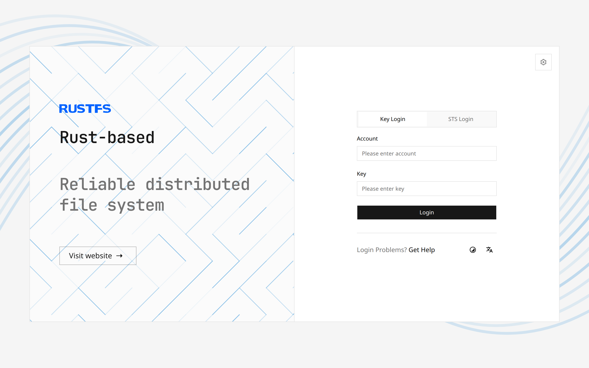

# RustFS Launcher

[English](README.md) · **Deutsch** · [Français](README_FR.md) · [日本語](README_JA.md) · [한국어](README_KO.md) · [简体中文](README_ZH.md) · [हिन्दी](README_HI.md)

RustFS Launcher ist eine kleine Desktop-Anwendung, die [RustFS](https://github.com/rustfs/rustfs) – einen
S3-kompatiblen Objektspeicher – auf dem eigenen Rechner startet. Sie wählen einen Ordner aus, drücken einen
Knopf und haben einen S3-Endpunkt unter `http://127.0.0.1:9000`.

Der Server steckt bereits in der Anwendung. Es gibt nichts weiter zu installieren, kein Terminal zu öffnen und
keine Konfigurationsdatei zu bearbeiten.


## Wofür Sie ihn benutzen können

- Objektspeicher auf dem eigenen Laptop betreiben – für Entwicklung, Tests oder als privates Backup-Ziel, ganz
  ohne Docker.
- Einen beliebigen S3-Client oder ein SDK auf `127.0.0.1` richten und wie einen Bucket in der Cloud benutzen.
- Den Server im Blick behalten: Status, belegte Ports und laufende Protokolle.
- RustFS jederzeit starten und stoppen. Der Launcher bleibt im Infobereich, während der Server arbeitet.
- Den Launcher – und das darin enthaltene RustFS – aus der Anwendung heraus aktualisieren.

## Herunterladen

Die passende Datei finden Sie auf der [Release-Seite](https://github.com/rustfs/launcher/releases).
Release **1.0.6** ist das aktuelle neueste Release.

| System | Datei |
| --- | --- |
| Windows 10 / 11, 64 Bit | `rustfs-launcher-windows-x86_64-<version>-setup.exe` |
| macOS, Apple Silicon | `rustfs-launcher-macos-aarch64-<version>.dmg` und `rustfs-launcher-macos-aarch64-<version>.app.zip` |
| macOS, Intel (x86_64) | In Release 1.0.6 nicht veröffentlicht |

In 1.0.6 heißen die Dateien `rustfs-launcher-windows-x86_64-1.0.6-setup.exe`,
`rustfs-launcher-macos-aarch64-1.0.6.dmg` und `rustfs-launcher-macos-aarch64-1.0.6.app.zip`. Ein Paket
`rustfs-launcher-macos-x86_64-*` gibt es nicht; ein Intel-Mac kann dieses Release nicht installieren.

Windows on ARM funktioniert ebenfalls – dort läuft der x86_64-Build per Emulation. Ein Linux-Paket des Launchers
gibt es nicht; unter Linux starten Sie die [RustFS-Binärdatei](https://github.com/rustfs/rustfs/releases) direkt.

Die Downloads sind groß, weil ein vollständiger RustFS-Server mit im Installationsprogramm steckt.

Dateien mit `-latest` im Namen auf demselben Release sind bytegleiche Kopien der versionierten Installer.
`rustfs-launcher-windows-x86_64-latest-setup.exe` und `rustfs-launcher-windows-x86_64-latest.exe` sind dieser
Windows-Installer unter festen Namen. `-latest.dmg` und `-latest.app.zip` für macOS sind dieselbe Art Kopie.
Nehmen Sie bevorzugt die versionierte `-setup.exe` oder die `.dmg`.

### Download prüfen

Laden Sie auf derselben Release-Seite unter **Assets** die Datei `SHA256SUMS` herunter. Jede Zeile enthält einen
SHA-256-Hash und den Dateinamen.

Unter Windows, in PowerShell, im Ordner des Installers:

```powershell
Get-FileHash .\rustfs-launcher-windows-x86_64-1.0.6-setup.exe -Algorithm SHA256
```

Unter macOS, im Terminal:

```bash
shasum -a 256 rustfs-launcher-macos-aarch64-1.0.6.dmg
```

Der Hash muss zur Zeile mit genau diesem Dateinamen in `SHA256SUMS` passen. Groß- und Kleinschreibung spielen
keine Rolle. Haben Sie die `.app.zip` geladen, prüfen Sie diesen Dateinamen auf dieselbe Weise. Bei einem
späteren Release verwenden Sie die Dateinamen und die `SHA256SUMS` von dort.

## Windows, Schritt für Schritt

### 1. Installationsprogramm herunterladen

Öffnen Sie die [Release-Seite](https://github.com/rustfs/launcher/releases), klappen Sie beim neuesten Release
**Assets** auf und laden Sie `rustfs-launcher-windows-x86_64-<version>-setup.exe` herunter (bei 1.0.6
`rustfs-launcher-windows-x86_64-1.0.6-setup.exe`). Vergleichen Sie die Datei wie oben mit `SHA256SUMS`. Edge und
Chrome warnen manchmal bei selten heruntergeladenen Installationsprogrammen; wählen Sie dann **Beibehalten**.

### 2. An SmartScreen vorbei

Doppelklicken Sie die Datei. Erscheint **Der Computer wurde durch Windows geschützt**, klicken Sie auf
**Weitere Informationen** und dann auf **Trotzdem ausführen**. Die Warnung kommt daher, dass das
Installationsprogramm noch nicht mit einem kommerziellen Zertifikat signiert ist – sie ist kein Urteil über die
Datei selbst.

### 3. Durch den Assistenten klicken

Der Assistent stellt die üblichen Fragen: Willkommen, Lizenz, Installationsort, Startmenü-Ordner.

- Voreingestellt ist `C:\Users\<Name>\AppData\Local\RustFS Launcher`. Die Installation erfolgt nur für Ihr
  Benutzerkonto, deshalb fragt Windows nicht nach Administratorrechten.
- Fehlt auf dem PC die Microsoft-WebView2-Laufzeit, lädt das Installationsprogramm sie einmalig nach. Dafür wird
  eine Internetverbindung gebraucht.
- Lassen Sie auf der letzten Seite **Run RustFS Launcher** angehakt. Eine Desktop-Verknüpfung können Sie dort
  ebenfalls anlegen lassen.

Danach liegt die Anwendung im Startmenü unter **RustFS Launcher**.

### 4. Einen Ordner für die Daten anlegen

RustFS legt Objekte in einem Ordner Ihrer Wahl ab und erwartet, dass es diesen Ordner bereits gibt. Legen Sie
also zuerst im Explorer etwas wie `D:\RustFS\data` an. Am sichersten ist ein leerer Ordner auf einem Laufwerk
mit freiem Platz.

Seine eigenen Protokolldateien schreibt der Server in einen `logs`-Ordner neben dem gewählten Ordner – in
diesem Beispiel also `D:\RustFS\logs`.

### 5. Das Formular ausfüllen



| Feld | Bedeutung |
| --- | --- |
| **Data Path** | Der Ordner aus Schritt 4. Über **Browse** auswählen oder einen Ordner ins Fenster ziehen. Das einzige Pflichtfeld. |
| **API Port** | Der Port des S3-Endpunkts. `9000`, sofern ihn nicht schon etwas anderes belegt. |
| **Host** | `127.0.0.1` hält den Server auf diesem Rechner. Mit `0.0.0.0` erreichen ihn auch andere Geräte im Netz. |
| **Console Endpoint** | Einschalten, wenn Sie die RustFS-Weboberfläche möchten. Sie läuft auf einem eigenen Port, standardmäßig `9001`. |
| **Access Key** / **Secret Key** | Die Zugangsdaten für Ihren S3-Client. Voreingestellt sind `rustfsadmin` / `rustfsadmin`, und sie werden mit dem Formular gespeichert. Auf einem Host, der nicht die lokale Loopback-Adresse ist, startet der Launcher nicht, solange beide noch der Vorgabe entsprechen; ein leeres Feld fällt ebenfalls auf dieses öffentliche Paar zurück. |

Die Eingaben werden gemerkt, der nächste Start ist also ein einziger Klick.

### 6. Auf Launch drücken

Klicken Sie auf **Launch RustFS**. Nach ein, zwei Sekunden steht in der Kopfzeile **Service Online / Managed by
Launcher**, das Formular sperrt sich, und unter **App Logs** steht, was der Launcher getan hat: welche
Binärdatei er genommen hat, mit welchen Argumenten er sie gestartet hat und welche Prozess-ID zurückkam.

Schlägt der Start fehl, steht der Grund im selben Protokollbereich. Am häufigsten sind ein Datenordner, den es
nicht gibt, und ein bereits belegter Port.

### 7. Den Speicher benutzen

Solange der Dienst online ist, lassen sich die Karten **API** und **Console** oben anklicken. **Console** öffnet
die Weboberfläche; **API** öffnet den S3-Endpunkt selbst, von dem ein Browser nur eine XML-Antwort bekommt –
diese Adresse ist für S3-Clients gedacht.

Richten Sie einen S3-Client auf den Endpunkt:

```bash
aws --endpoint-url http://127.0.0.1:9000 s3 mb s3://demo
aws --endpoint-url http://127.0.0.1:9000 s3 cp bericht.pdf s3://demo/
```

Als Zugangsdaten dienen Access Key und Secret Key, als Region `us-east-1`, und die Adressierung erfolgt im
Path-Style.

In der Konsole melden Sie sich mit demselben Access Key und Secret Key an.



### 8. Stoppen oder weiterlaufen lassen

**Stop RustFS** fährt den Server herunter und gibt das Formular wieder frei.

Das Schließen des Fensters beendet nichts: Der Launcher versteckt sich im Infobereich, RustFS läuft weiter. Ein
Klick auf das Symbol holt das Fenster zurück; über die rechte Maustaste und **Quit** stoppen Sie den Server und
beenden die Anwendung.

### 9. Deinstallieren

Entfernen Sie **RustFS Launcher** über **Einstellungen → Apps → Installierte Apps** oder über den Eintrag im
Startmenü-Ordner. Ihr Datenordner bleibt unangetastet; löschen Sie ihn selbst, wenn Sie die Objekte darin nicht
mehr brauchen.

## macOS

1. Öffnen Sie die `.dmg` und ziehen Sie **RustFS Launcher** nach **Programme**. Haben Sie stattdessen die
   `.app.zip` geladen, entpacken Sie sie und ziehen Sie die App auf dieselbe Weise.
2. Der erste Start wird blockiert, weil diese Builds nicht notarisiert sind. Klicken Sie die App mit der rechten
   Maustaste an, wählen Sie **Öffnen** und bestätigen Sie. Das Entfernen des Quarantäne-Attributs im Terminal ist
   optional:

   ```bash
   xattr -cr "/Applications/RustFS Launcher.app"
   open "/Applications/RustFS Launcher.app"
   ```

3. Danach gilt alles aus den Schritten 4 bis 8. Ein Klick auf das Dock-Symbol holt das Fenster zurück, nachdem
   Sie es geschlossen haben.

## Ein Rundgang durch das Fenster


### Sprache

Die Sprachschaltfläche (Globe-Symbol) sitzt oben rechts in der Kopfleiste. Ist die Oberfläche Arabisch, wird die
ganze Seite gespiegelt und die Schaltfläche erscheint links.

Beim ersten Start, bevor Sie eine Sprache gewählt haben, folgt die App der Sprache des Betriebssystems. Passt
sie zu einer der 15 eingebauten Sprachen, wird diese verwendet, sonst Englisch.

Diese 15 Sprachen stehen unter ihren eigenen Namen: English, العربية, 簡體中文, 繁體中文, 日本語, 한국어,
Deutsch, Français, Español, Português, Italiano, Русский, Türkçe, Bahasa Indonesia und Tiếng Việt. Die Kürzel
sind `en`, `ar`, `zh-CN`, `zh-TW`, `ja`, `ko`, `de`, `fr`, `es`, `pt`, `it`, `ru`, `tr`, `id` und `vi`.
Vereinfachtes Chinesisch gilt für `zh-Hans` und `zh-CN`. Traditionelles Chinesisch gilt für `zh-Hant`, `zh-TW`,
`zh-HK` und `zh-MO`.

Nach der Auswahl gilt die Sprache sofort und wird gespeichert. Die Sprache des Betriebssystems ersetzt sie
danach nicht mehr.

Das Menü im Infobereich (**Show** und **Quit**) und der Windows-Installationsassistent bleiben Englisch. Das
macOS-Paket ist ein Disk-Image zum Ziehen nach Programme, kein übersetzter Assistent. Die Sprachschaltfläche
ändert das Launcher-Fenster.

**Statusanzeigen.** Die erste betrifft den Server: *Service Online* heißt, dass auf dem eingestellten Host und
Port etwas antwortet. Die zweite sagt, wem dieser Prozess gehört:

| Anzeige | Bedeutung |
| --- | --- |
| Ready to Launch | Auf diesem Port läuft nichts. |
| Managed by Launcher | Der Launcher hat RustFS gestartet und kann es wieder stoppen. |
| Detected Externally | Der Port antwortet, aber der Prozess wurde nicht hier gestartet – etwa ein RustFS aus dem Terminal. Das Formular bleibt bearbeitbar, damit Sie den Port ändern können. Der Stopp-Knopf bleibt deaktiviert, weil dieser Launcher den Prozess nicht besitzt. |

**Übersichtskarten.** API und Console zeigen die Ports und öffnen sie im Browser, sobald der Dienst online ist.
Mode ist nur *Locked*, solange dieser Launcher RustFS selbst ausführt. Ein extern erkannter Server lässt das Formular *Editable*.

**Version & Updates.** Zeigt die Version des Launchers und die des eingebauten RustFS und sucht auf Wunsch nach
einem neueren Release.

**Protokolle.** *App Logs* ist der Launcher selbst: wonach er gesucht hat, was er gestartet hat, warum etwas
schiefging. *RustFS Output* zeigt, was der Server auf der Konsole ausgibt – neuere RustFS-Builds schreiben ihre
ausführlichen Protokolle in Dateien, deshalb bleibt dieser Reiter oft leer. Auto-scroll folgt neuen Zeilen,
Clear leert beide Reiter.

## Wo was landet

| Was | Wo |
| --- | --- |
| Ihre Objekte | Im gewählten Datenordner, dazu ein verstecktes `.rustfs.sys` für Metadaten |
| Server-Protokolle | In einem `logs`-Ordner neben dem Datenordner |
| Launcher-Einstellungen | Speichert die Anwendung selbst; es gibt keine Datei zum Bearbeiten |
| Die Anwendung | `%LOCALAPPDATA%\RustFS Launcher` unter Windows, `/Programme` unter macOS |

## Aktualisieren

Klicken Sie in der Karte Version & Updates auf **Check for Updates**. Gibt es ein neueres Release, lädt der
Launcher es herunter, prüft die Signatur und installiert es. Läuft gerade RustFS, fragt der Launcher nach und
stoppt den Server, bevor er sich selbst neu startet. Ein Update ersetzt die komplette Anwendung samt
mitgeliefertem RustFS-Server.

Signatur- und Release-Details stehen in [docs/SELF_UPDATE.md](docs/SELF_UPDATE.md).

## Wenn etwas nicht klappt

**„Data path does not exist“** – legen Sie den Ordner zuerst im Explorer oder Finder an; der Launcher erstellt
ihn nicht.

**„Port 9000 is already in use“** – ein anderes Programm (oder ein älteres RustFS) belegt den Port. Wählen Sie
einen anderen API-Port oder beenden Sie das andere Programm. Für den Konsolen-Port gilt dasselbe.

**Es steht Detected Externally** – auf diesem Host und Port antwortet bereits ein RustFS, das dieser Launcher
nicht gestartet hat. Beenden Sie diesen Prozess dort, wo Sie ihn gestartet haben, oder wechseln Sie den Port.

**RustFS Output bleibt leer** – das ist bei neueren RustFS-Builds normal, sie schreiben ihre Protokolle in den
`logs`-Ordner neben Ihrem Datenordner. Was der Launcher selbst tut, steht in den App Logs.

**Der Browser zeigt XML wie `AccessDenied`** – das ist die S3-API, die einem Browser antwortet; es ist nichts
kaputt. Für eine Weboberfläche nehmen Sie die Karte **Console**, die API-Adresse gehört in einen S3-Client.

**Das Fenster ist verschwunden** – Schließen versteckt es nur. Benutzen Sie das Symbol im Infobereich unter
Windows oder das Dock-Symbol unter macOS.

**macOS meldet, die App „kann nicht geöffnet werden“** – klicken Sie die App mit der rechten Maustaste an, wählen
Sie **Öffnen** und bestätigen Sie. Der `xattr`-Befehl im macOS-Abschnitt ist eine optionale Alternative.

## Selbst bauen

Sie brauchen [Rust](https://rustup.rs/), [Node.js](https://nodejs.org/) und [Trunk](https://trunkrs.dev/)
(`cargo install trunk`).

```bash
./build.sh          # unter Windows build.bat – lädt die passende RustFS-Binärdatei
cargo tauri dev     # mit Hot Reload starten
cargo tauri build   # Installationspakete erzeugen
```

Führen Sie vor einem Pull Request `make pre-commit` aus; das prüft Formatierung, Clippy, den Frontend-Build und
die Tests. Mehr Details stehen in [AGENTS.md](AGENTS.md), die Release-Workflows in
[.github/ACTIONS.md](.github/ACTIONS.md). Zum Entwickeln eignet sich VS Code mit den Erweiterungen
[Tauri](https://marketplace.visualstudio.com/items?itemName=tauri-apps.tauri-vscode) und
[rust-analyzer](https://marketplace.visualstudio.com/items?itemName=rust-lang.rust-analyzer).

## Lizenz

Apache-2.0, siehe [LICENSE](LICENSE).
