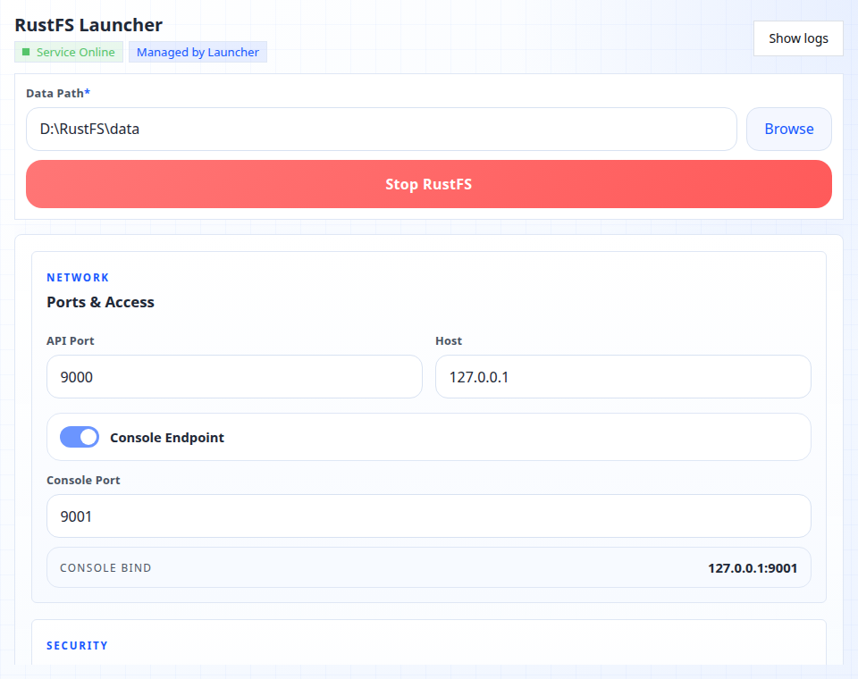

# RustFS Launcher

[English](README.md) · [Deutsch](README_DE.md) · **Français** · [日本語](README_JA.md) · [한국어](README_KO.md) · [简体中文](README_ZH.md) · [हिन्दी](README_HI.md)

RustFS Launcher est une petite application de bureau qui fait tourner [RustFS](https://github.com/rustfs/rustfs),
un serveur de stockage objet compatible S3, sur votre propre machine. Vous choisissez un dossier, vous appuyez
sur un bouton, et vous obtenez un point de terminaison S3 à l'adresse `http://127.0.0.1:9000`.

Le serveur est déjà inclus dans l'application. Rien d'autre à installer, aucun terminal à ouvrir, aucun fichier
de configuration à modifier.



## À quoi ça sert

- Faire tourner du stockage objet sur son portable pour développer, tester ou sauvegarder, sans Docker.
- Diriger n'importe quel client ou SDK S3 vers `127.0.0.1` et l'utiliser comme un bucket dans le cloud.
- Garder un œil sur le serveur : état et ports utilisés. Les journaux restent cachés tant que vous ne les ouvrez pas.
- Démarrer et arrêter RustFS quand vous le voulez. Le launcher reste dans la zone de notification pendant que le
  serveur travaille.
- Mettre à jour le launcher — et le RustFS qu'il embarque — depuis l'application elle-même.

## Téléchargement

Prenez le fichier qui correspond à votre machine sur la
[page des versions](https://github.com/rustfs/launcher/releases).
La version **1.0.6** est la dernière version publiée.

| Votre système | Fichier |
| --- | --- |
| Windows 10 / 11, 64 bits | `rustfs-launcher-windows-x86_64-<version>-setup.exe` |
| macOS, Apple Silicon | `rustfs-launcher-macos-aarch64-<version>.dmg` et `rustfs-launcher-macos-aarch64-<version>.app.zip` |
| macOS, Intel (x86_64) | Absent de la version 1.0.6 |

Pour 1.0.6, les fichiers sont `rustfs-launcher-windows-x86_64-1.0.6-setup.exe`,
`rustfs-launcher-macos-aarch64-1.0.6.dmg` et `rustfs-launcher-macos-aarch64-1.0.6.app.zip`. Il n'y a pas de
paquet `rustfs-launcher-macos-x86_64-*` : un Mac Intel ne peut pas installer cette version.

Windows sur ARM fonctionne aussi : la version x86_64 s'exécute par émulation. Il n'y a pas de paquet Linux du
launcher ; sous Linux, lancez directement le [binaire RustFS](https://github.com/rustfs/rustfs/releases).

Les fichiers sont volumineux parce qu'un serveur RustFS complet est embarqué dans l'installeur.

Les noms qui contiennent `-latest` sur cette même version sont des copies identiques des installeurs versionnés.
`rustfs-launcher-windows-x86_64-latest-setup.exe` et `rustfs-launcher-windows-x86_64-latest.exe` sont cet
installeur Windows sous des noms stables. Les fichiers macOS `-latest.dmg` et `-latest.app.zip` sont le même
genre de copie. Préférez le `-setup.exe` ou le `.dmg` qui portent le numéro de version.

### Vérifier le téléchargement

Sur la même page de version, dans **Assets**, téléchargez `SHA256SUMS` à côté de l'installeur. Chaque ligne
contient un condensé SHA-256 et le nom du fichier.

Sous Windows, dans PowerShell, depuis le dossier de l'installeur :

```powershell
Get-FileHash .\rustfs-launcher-windows-x86_64-1.0.6-setup.exe -Algorithm SHA256
```

Sous macOS, dans le Terminal :

```bash
shasum -a 256 rustfs-launcher-macos-aarch64-1.0.6.dmg
```

Le condensé doit correspondre à la ligne de ce nom de fichier exact dans `SHA256SUMS`. La casse des lettres n'a
pas d'importance. Si vous avez téléchargé le `.app.zip`, vérifiez ce nom de fichier de la même façon. Pour une
version plus récente, utilisez les noms de fichiers et le `SHA256SUMS` de cette version.

## Windows, étape par étape

### 1. Télécharger l'installeur

Ouvrez la [page des versions](https://github.com/rustfs/launcher/releases), dépliez **Assets** sur la version la
plus récente et téléchargez `rustfs-launcher-windows-x86_64-<version>-setup.exe` (pour 1.0.6,
`rustfs-launcher-windows-x86_64-1.0.6-setup.exe`). Comparez-le à `SHA256SUMS` comme indiqué plus haut. Edge et
Chrome signalent parfois les installeurs qu'ils voient rarement ; choisissez **Conserver** si le navigateur le
demande.

### 2. Passer SmartScreen

Double-cliquez sur le fichier. Si **Windows a protégé votre ordinateur** s'affiche, cliquez sur **Informations
complémentaires**, puis sur **Exécuter quand même**. Cet avertissement apparaît parce que l'installeur n'est pas
encore signé avec un certificat commercial — ce n'est pas un jugement sur le fichier.

### 3. Dérouler l'assistant

L'assistant pose les questions habituelles : bienvenue, licence, dossier d'installation, dossier du menu
Démarrer.

- L'emplacement par défaut est `C:\Users\<vous>\AppData\Local\RustFS Launcher`. L'installation ne concerne que
  votre compte, Windows ne demandera donc pas de droits administrateur.
- S'il manque le runtime Microsoft WebView2, l'installeur le télécharge une fois. Cette étape nécessite une
  connexion à Internet.
- Sur la dernière page, laissez **Run RustFS Launcher** coché. Vous pouvez aussi demander un raccourci sur le
  bureau.

L'application se trouve ensuite dans le menu Démarrer, sous **RustFS Launcher**.

### 4. Créer un dossier pour les données

RustFS range les objets dans un dossier que vous choisissez, et il attend que ce dossier existe déjà. Créez
d'abord quelque chose comme `D:\RustFS\data` dans l'Explorateur. Un dossier vide sur un disque avec de la place
est le choix le plus sûr.

Le serveur écrit ses propres journaux dans un dossier `logs` voisin du vôtre — ici `D:\RustFS\logs`.

### 5. Remplir le formulaire


| Champ | Signification |
| --- | --- |
| **Data Path** | Le dossier de l'étape 4. Cliquez sur **Browse** ou faites glisser un dossier sur la fenêtre. C'est le seul champ obligatoire. |
| **API Port** | Le port du point de terminaison S3. `9000`, sauf si un autre programme l'occupe déjà. |
| **Host** | `127.0.0.1` garde le serveur sur cette machine. Utilisez `0.0.0.0` pour le rendre accessible aux autres machines du réseau. |
| **Console Endpoint** | Activez-le si vous voulez la console web de RustFS. Elle utilise son propre port, `9001` par défaut. |
| **Access Key** / **Secret Key** | Les identifiants qu'utilisera votre client S3. Par défaut `rustfsadmin` / `rustfsadmin`, et ils sont mémorisés avec le formulaire. Le launcher refuse de démarrer sur un hôte qui n'est pas en boucle locale tant que les deux n'ont pas été changés ; un champ vide retombe aussi sur cette paire publique. |

Vos saisies sont mémorisées : le démarrage suivant tient en un clic.

### 6. Appuyer sur Launch

La fenêtre s'ouvre sur **Data Path** et **Launch RustFS**. Inutile de faire défiler pour les atteindre. Les
journaux restent cachés jusqu'à **Show logs**. **Hide logs** referme le panneau. Un contrôle au démarrage ou un
message de mise à jour ne l'ouvre pas.

Cliquez sur **Launch RustFS**. En une seconde ou deux, l'état passe à **Service Online / Managed by
Launcher** et le formulaire se verrouille.

Si le démarrage, l'arrêt ou une mise à jour échoue, le premier écran indique la raison et comment la corriger.
Le panneau des journaux reste fermé. Les échecs les plus fréquents : un dossier de données inexistant et un port
déjà pris. RustFS écrit aussi le détail dans le dossier `logs` à côté du dossier de données. **Show logs** sert
seulement si vous voulez le détail ligne à ligne.

### 7. Utiliser le stockage

Tant que le service est en ligne, les cartes **API** et **Console** sous le bouton de lancement deviennent cliquables. **Console**
ouvre l'interface web ; **API** ouvre le point de terminaison S3 lui-même, dont un navigateur ne reçoit qu'une
réponse XML — cette adresse est faite pour les clients S3.

Dirigez un client S3 vers le point de terminaison :

```bash
aws --endpoint-url http://127.0.0.1:9000 s3 mb s3://demo
aws --endpoint-url http://127.0.0.1:9000 s3 cp rapport.pdf s3://demo/
```

Utilisez votre access key et votre secret key comme identifiants, `us-east-1` comme région, et l'adressage de
type path-style.

Dans la console, connectez-vous avec ces mêmes access key et secret key.


### 8. Arrêter le serveur, ou le laisser tourner

**Stop RustFS** arrête le serveur et déverrouille le formulaire.

Fermer la fenêtre n'arrête rien : le launcher se cache dans la zone de notification et RustFS continue de
servir. Cliquez sur l'icône pour revenir à la fenêtre, ou faites un clic droit puis **Quit** pour arrêter le
serveur et quitter l'application.

### 9. Désinstaller

Supprimez **RustFS Launcher** depuis **Paramètres → Applications → Applications installées**, ou par le
désinstalleur présent dans son dossier du menu Démarrer. Votre dossier de données n'est pas touché ; supprimez-le
vous-même si vous n'en avez plus besoin.

## macOS

1. Ouvrez le `.dmg` et glissez **RustFS Launcher** dans **Applications**. Si vous avez téléchargé le `.app.zip`,
   décompressez-le et glissez l'application de la même façon.
2. Le premier lancement est bloqué, car ces builds ne sont pas notariés. Faites un clic droit sur l'application,
   choisissez **Ouvrir**, puis confirmez. Retirer l'attribut de quarantaine dans le Terminal est facultatif :

   ```bash
   xattr -cr "/Applications/RustFS Launcher.app"
   open "/Applications/RustFS Launcher.app"
   ```

3. Ensuite, tout se passe comme aux étapes 4 à 8. Un clic sur l'icône du Dock ramène la fenêtre après que vous
   l'avez fermée.

## Visite guidée de la fenêtre


Le premier écran montre **Data Path**, **Browse** et **Launch RustFS**, avec l'état du service à côté du titre.
Les journaux n'apparaissent pas tant que vous ne les ouvrez pas.

### Langue

Utilisez les boutons de langue (**中** / **EN** / **FR** / **日**) dans la barre supérieure pour changer la
langue de l'interface.

Au premier lancement, tant que vous n'avez pas choisi de langue, l'application suit la langue du système (selon
la sous-balise principale, par exemple `zh-CN`, `zh-Hant-TW`, `fr-CA` ou `ja_JP`). Si elle fait partie des
4 langues intégrées, elle est utilisée ; sinon l'interface est en anglais.

Les 4 langues intégrées sont 简体中文 (`zh-CN`), English (`en`), Français (`fr`) et 日本語 (`ja`).

Dès que vous choisissez une langue, elle s'applique tout de suite et elle est mémorisée. La langue du système ne
la remplace plus ensuite.

Le menu de la zone de notification (**Show** et **Quit**), l'assistant d'installation Windows, les messages
d'erreur du backend et les lignes de journal restent en anglais. Le paquet macOS est une image disque à glisser
dans Applications, pas un assistant traduit. Les boutons de langue changent la fenêtre du launcher.

**Les badges d'état.** Le premier parle du serveur : *Service Online* signifie que quelque chose répond sur
l'hôte et le port configurés. Le second dit à qui appartient ce processus :

| Badge | Signification |
| --- | --- |
| Ready to Launch | Rien ne tourne sur ce port. |
| Managed by Launcher | Le launcher a démarré RustFS et peut l'arrêter. |
| Detected Externally | Le port répond, mais le processus n'a pas été lancé ici — par exemple un RustFS démarré depuis un terminal. Le formulaire reste modifiable pour changer le port. Le bouton d'arrêt reste désactivé, car ce launcher ne possède pas ce processus. |

**Les cartes de résumé.** API et Console affichent les ports et les ouvrent dans le navigateur une fois le
service en ligne. Mode n'est *Locked* que pendant que ce launcher exécute lui-même RustFS. Un serveur détecté à l'extérieur laisse le formulaire *Editable*.

**Version & Updates.** Affiche la version du launcher et celle du RustFS intégré, et cherche une version plus
récente quand vous le demandez.

**Les journaux.** Cachés au lancement. **Show logs** ouvre le panneau ; les contrôles au démarrage et les messages
de mise à jour ne l'ouvrent pas. *App Logs*, c'est le launcher qui parle : ce qu'il a cherché, ce qu'il a démarré, pourquoi
quelque chose a échoué. *RustFS Output* montre ce que le serveur écrit sur sa console — les versions récentes de
RustFS écrivent leurs journaux détaillés dans des fichiers, cet onglet reste donc souvent vide une fois ouvert. Auto-scroll suit
les nouvelles lignes, Clear vide les deux onglets.

## Où atterrissent les fichiers

| Quoi | Où |
| --- | --- |
| Vos objets | Le dossier de données choisi, plus un dossier caché `.rustfs.sys` pour les métadonnées |
| Journaux du serveur | Un dossier `logs` à côté du dossier de données |
| Réglages du launcher | Conservés par l'application ; aucun fichier à éditer |
| L'application | `%LOCALAPPDATA%\RustFS Launcher` sous Windows, `/Applications` sous macOS |

## Mises à jour

Cliquez sur **Check for Updates** dans la carte Version & Updates. S'il existe une version plus récente, le
launcher la télécharge, vérifie sa signature et l'installe. Si RustFS tourne, il demande d'abord confirmation,
puis arrête le serveur avant de redémarrer. Une mise à jour remplace toute l'application, y compris le serveur
RustFS embarqué.

Les détails de signature et de publication sont dans [docs/SELF_UPDATE.md](docs/SELF_UPDATE.md).

## En cas de problème

**« Data path does not exist »** — créez d'abord le dossier dans l'Explorateur ou le Finder ; le launcher ne le
crée pas à votre place.

**« Port 9000 is already in use »** — un autre programme (ou un ancien RustFS) occupe le port. Choisissez un
autre port d'API ou arrêtez ce programme. Même chose pour le port de la console.

**Le badge affiche Detected Externally** — un RustFS répond déjà sur cet hôte et ce port, mais ce launcher ne
l'a pas démarré. Arrêtez ce processus là où vous l'avez lancé, ou changez de port.

**RustFS Output reste vide** — une fois les journaux ouverts, cet onglet est souvent calme. Les versions récentes
de RustFS écrivent dans le dossier `logs` voisin de votre dossier de données. L'autre onglet, App Logs, montre ce
que fait le launcher.

**Le navigateur affiche du XML du type `AccessDenied`** — c'est l'API S3 qui répond à un navigateur, rien n'est
cassé. Pour une interface web, passez par la carte **Console** ; l'adresse de l'API, elle, est faite pour un
client S3.

**La fenêtre a disparu** — la fermer ne fait que la masquer. Utilisez l'icône de la zone de notification sous
Windows, ou celle du Dock sous macOS.

**macOS dit que l'application « ne peut pas être ouverte »** — faites un clic droit sur l'application, choisissez
**Ouvrir**, puis confirmez. La commande `xattr` de la section macOS est une alternative facultative.

## Compiler soi-même

Il vous faut [Rust](https://rustup.rs/), [Node.js](https://nodejs.org/) et [Trunk](https://trunkrs.dev/)
(`cargo install trunk`).

```bash
./build.sh          # build.bat sous Windows — télécharge le binaire RustFS de votre plateforme
cargo tauri dev     # lancer avec rechargement à chaud
cargo tauri build   # produire les installeurs
```

Lancez `make pre-commit` avant d'ouvrir une pull request : formatage, Clippy, build du frontend et tests. Les
détails sont dans [AGENTS.md](AGENTS.md), les workflows de publication dans
[.github/ACTIONS.md](.github/ACTIONS.md). Pour éditer le code, VS Code avec les extensions
[Tauri](https://marketplace.visualstudio.com/items?itemName=tauri-apps.tauri-vscode) et
[rust-analyzer](https://marketplace.visualstudio.com/items?itemName=rust-lang.rust-analyzer) fait très bien
l'affaire.

## Licence

Apache-2.0, voir [LICENSE](LICENSE).
