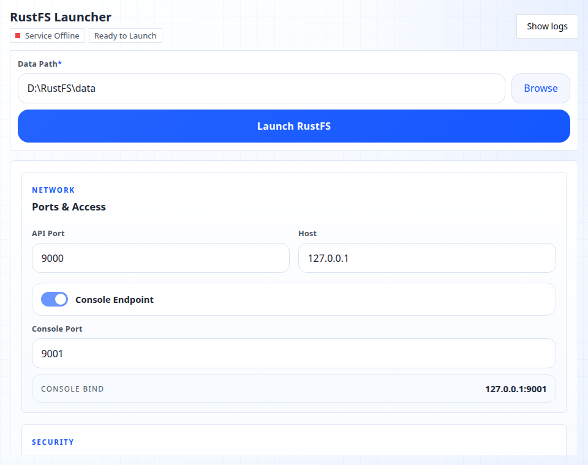

# RustFS Launcher

[English](README.md) · [Deutsch](README_DE.md) · [Français](README_FR.md) · **日本語** · [한국어](README_KO.md) · [简体中文](README_ZH.md) · [हिन्दी](README_HI.md)

RustFS Launcher は、S3 互換のオブジェクトストレージ [RustFS](https://github.com/rustfs/rustfs) を手元の
パソコンで動かすための小さなデスクトップアプリです。フォルダーを選んでボタンを 1 回押せば、
`http://127.0.0.1:9000` に S3 のエンドポイントができあがります。

サーバー本体はアプリに同梱されています。別途インストールするものはなく、ターミナルを開く必要も、
設定ファイルを書く必要もありません。


## こんなときに使えます

- Docker を使わずに、開発やテスト、個人のバックアップ先としてノート PC でオブジェクトストレージを動かす。
- 好きな S3 クライアントや SDK を `127.0.0.1` に向けて、クラウドのバケットと同じように使う。
- サーバーの状態、使用中のポート、リアルタイムのログを確認する。
- 好きなタイミングで RustFS を起動・停止する。サーバーが動いている間、ランチャーはトレイに常駐します。
- ランチャー本体（同梱の RustFS も含めて）をアプリ内から更新する。

## ダウンロード

[リリースページ](https://github.com/rustfs/launcher/releases) から、お使いの環境に合うファイルを取得します。
現在の最新リリースは **1.0.6** です。

| 環境 | ファイル |
| --- | --- |
| Windows 10 / 11（64 ビット） | `rustfs-launcher-windows-x86_64-<version>-setup.exe` |
| macOS（Apple シリコン） | `rustfs-launcher-macos-aarch64-<version>.dmg` と `rustfs-launcher-macos-aarch64-<version>.app.zip` |
| macOS（Intel、x86_64） | リリース 1.0.6 にはありません |

1.0.6 のファイル名は `rustfs-launcher-windows-x86_64-1.0.6-setup.exe`、
`rustfs-launcher-macos-aarch64-1.0.6.dmg`、`rustfs-launcher-macos-aarch64-1.0.6.app.zip` です。
`rustfs-launcher-macos-x86_64-*` はなく、Intel Mac はこのリリースをインストールできません。

Windows on ARM でも動きます。x86_64 版がエミュレーションで実行されます。Linux 向けのランチャーパッケージはありません。
Linux では [RustFS のバイナリ](https://github.com/rustfs/rustfs/releases) を直接実行してください。

ファイルサイズが大きいのは、RustFS サーバーがまるごとインストーラーに入っているためです。

同じリリースで名前に `-latest` を含むファイルは、バージョン付きインストーラーとバイト単位で同じコピーです。
`rustfs-launcher-windows-x86_64-latest-setup.exe` と `rustfs-launcher-windows-x86_64-latest.exe` は、その
Windows インストーラーを安定したファイル名にしたものです。macOS の `-latest.dmg` と `-latest.app.zip` も同じ種類のコピーです。
バージョン付きの `-setup.exe` または `.dmg` を優先してください。

### ダウンロードを確認する

同じリリースページの **Assets** から、インストーラーと一緒に `SHA256SUMS` を入手します。各行は SHA-256 ハッシュとファイル名です。

Windows では、インストーラーのあるフォルダーで PowerShell を開きます。

```powershell
Get-FileHash .\rustfs-launcher-windows-x86_64-1.0.6-setup.exe -Algorithm SHA256
```

macOS では、ターミナルで次を実行します。

```bash
shasum -a 256 rustfs-launcher-macos-aarch64-1.0.6.dmg
```

ハッシュは `SHA256SUMS` の、そのファイル名の行と一致する必要があります。英字の大文字と小文字は区別しません。
`.app.zip` を入手した場合は、そのファイル名で同じように確認します。以後のリリースでは、そのリリースのファイル名と
`SHA256SUMS` を使ってください。

## Windows での手順

### 1. インストーラーをダウンロードする

[リリースページ](https://github.com/rustfs/launcher/releases) を開き、最新リリースの **Assets** を展開して、
`rustfs-launcher-windows-x86_64-<version>-setup.exe` をダウンロードします（1.0.6 では
`rustfs-launcher-windows-x86_64-1.0.6-setup.exe`）。上の手順で `SHA256SUMS` と照合してください。Edge や
Chrome は、あまり見かけないインストーラーに警告を出すことがあります。確認されたら「保存」を選んでください。

### 2. SmartScreen を通過する

ファイルをダブルクリックします。**「Windows によって PC が保護されました」** と表示されたら、
**詳細情報** をクリックし、**実行** を選びます。この警告は、インストーラーに商用の署名証明書がまだ
付いていないために出るもので、ファイルそのものの問題を示すものではありません。

### 3. ウィザードを進める

ウィザードでは、ようこそ画面、ライセンス、インストール先、スタートメニューのフォルダーを順に確認します。

- 既定のインストール先は `C:\Users\<ユーザー名>\AppData\Local\RustFS Launcher` です。ユーザー単位の
  インストールなので、管理者権限は求められません。
- Microsoft WebView2 ランタイムが入っていない PC では、インストーラーが一度だけダウンロードします。
  この手順にはインターネット接続が必要です。
- 最後の画面では **Run RustFS Launcher** にチェックを入れたままにします。デスクトップのショートカットも
  ここで作成できます。

インストール後は、スタートメニューの **RustFS Launcher** から起動できます。

### 4. データ用のフォルダーを作る

RustFS は指定したフォルダーにオブジェクトを保存します。フォルダーはあらかじめ存在している必要があるので、
先にエクスプローラーで `D:\RustFS\data` のようなフォルダーを作ってください。空き容量のあるドライブの
空フォルダーが無難です。

サーバー自身のログファイルは、そのフォルダーと同じ階層の `logs` フォルダー（この例では `D:\RustFS\logs`）に
書き込まれます。

### 5. フォームを入力する


| 項目 | 意味 |
| --- | --- |
| **Data Path** | 手順 4 のフォルダー。**Browse** で選ぶか、ウィンドウにフォルダーをドラッグします。必須項目はここだけです。 |
| **API Port** | S3 エンドポイントのポート。他のソフトが使っていなければ `9000` のままで構いません。 |
| **Host** | `127.0.0.1` ならこのパソコンの中だけで使えます。`0.0.0.0` にすると同じネットワークの他の端末からも接続できます。 |
| **Console Endpoint** | RustFS の Web コンソールを使う場合にオンにします。既定では `9001` という別のポートを使います。 |
| **Access Key** / **Secret Key** | S3 クライアントから使う認証情報です。初期値は `rustfsadmin` / `rustfsadmin` で、フォームの他の項目と一緒に保存されます。ループバック以外のホストでは、両方を初期値から変えるまでランチャーは起動を拒否します。空欄のままでも、この公開された組に戻ります。 |

入力内容は保存されるので、次回からはクリック 1 回で起動できます。

### 6. Launch を押す

**Launch RustFS** をクリックします。1〜2 秒でヘッダーが **Service Online / Managed by Launcher** に変わり、
フォームはロックされ、**App Logs** にランチャーの動作（選択したバイナリ、渡した引数、取得したプロセス ID）が
表示されます。

起動に失敗した場合も、理由は同じログ欄に出ます。よくあるのは、データフォルダーが存在しないケースと、
ポートがすでに使われているケースです。

### 7. ストレージを使う

サービスがオンラインの間は、上部の **API** と **Console** のカードをクリックできます。**Console** は Web 画面を
開きます。**API** は S3 エンドポイントそのものを開くため、ブラウザーでは XML が返るだけです。このアドレスは
S3 クライアントから使うためのものです。

S3 クライアントからエンドポイントに接続します。

```bash
aws --endpoint-url http://127.0.0.1:9000 s3 mb s3://demo
aws --endpoint-url http://127.0.0.1:9000 s3 cp report.pdf s3://demo/
```

認証情報にはアクセスキーとシークレットキーを、リージョンには `us-east-1` を指定し、パススタイルの
アドレッシングを使います。

コンソールには、同じアクセスキーとシークレットキーでサインインします。


### 8. 停止する、または動かしたままにする

**Stop RustFS** でサーバーを停止すると、フォームのロックも解除されます。

ウィンドウを閉じても終了はしません。ランチャーは通知領域に隠れ、RustFS はそのまま動き続けます。トレイ
アイコンをクリックするとウィンドウが戻り、右クリックの **Quit** を選ぶとサーバーを停止してアプリを終了します。

### 9. アンインストール

**設定 → アプリ → インストールされているアプリ** から **RustFS Launcher** を削除するか、スタートメニューの
フォルダーにあるアンインストーラーを使います。データフォルダーはそのまま残るので、不要になったら自分で
削除してください。

## macOS

1. `.dmg` を開き、**RustFS Launcher** を **アプリケーション** にドラッグします。`.app.zip` を入手した場合は
   展開して、同じようにドラッグします。
2. これらのビルドは公証されていないため、初回起動はブロックされます。アプリを右クリックして **開く** を選び、
   確認してください。ターミナルで隔離属性を外す操作は任意です。

   ```bash
   xattr -cr "/Applications/RustFS Launcher.app"
   open "/Applications/RustFS Launcher.app"
   ```

3. あとは手順 4〜8 と同じです。ウィンドウを閉じたあとは、Dock のアイコンをクリックすれば戻ります。

## 画面の見かた



### 言語

言語ボタン（Globe アイコン）はヘッダーの右上にあります。表示がアラビア語のときはページ全体が左右反転し、ボタンは左側に出ます。

まだ言語を選んでいない初回起動では、OS の言語に従います。それがアプリ内の 15 言語のどれかならその言語、そうでなければ英語です。

15 言語はそれぞれの名称で並びます。English、العربية、簡體中文、繁體中文、日本語、한국어、Deutsch、
Français、Español、Português、Italiano、Русский、Türkçe、Bahasa Indonesia、Tiếng Việt。コードは
`en`、`ar`、`zh-CN`、`zh-TW`、`ja`、`ko`、`de`、`fr`、`es`、`pt`、`it`、`ru`、`tr`、`id`、`vi` です。
簡体字中国語は `zh-Hans` と `zh-CN`、繁体字中国語は `zh-Hant`、`zh-TW`、`zh-HK`、`zh-MO` に対応します。

選んだ言語はすぐに反映され、記憶されます。その後は OS の言語では上書きされません。

トレイメニュー（**Show** と **Quit**）と Windows のセットアップウィザードは英語のままです。macOS の配布物はアプリケーションフォルダへドラッグするディスクイメージで、翻訳されたウィザードではありません。言語ボタンが変えるのはランチャーのウィンドウです。

**ステータス表示。** 1 つ目はサーバーの状態です。*Service Online* は、設定したホストとポートで何かが応答して
いることを意味します。2 つ目は、そのプロセスの持ち主を示します。

| 表示 | 意味 |
| --- | --- |
| Ready to Launch | そのポートでは何も動いていません。 |
| Managed by Launcher | ランチャーが RustFS を起動しており、停止もできます。 |
| Detected Externally | ポートは応答していますが、そのプロセスはここから起動されたものではありません（ターミナルから起動した RustFS など）。ポートを変えられるようフォームは編集可能なままです。停止ボタンは無効のままです。このランチャーはそのプロセスを持っていないためです。 |

**サマリーカード。** API と Console はポート番号を表示し、サービスがオンラインになるとブラウザーで開けます。
Mode が *Locked* になるのは、このランチャー自身が RustFS を実行している間だけです。外部で検出されたサーバーではフォームは *Editable* のままです。

**Version & Updates。** ランチャーのバージョンと、内蔵している RustFS のバージョンを表示し、指示すると
新しいリリースを確認します。

**ログ。** *App Logs* はランチャー自身の記録です（何を探し、何を起動し、なぜ失敗したか）。*RustFS Output* は
サーバーがコンソールに出力した内容ですが、最近の RustFS は詳細なログをファイルに書くため、このタブは
空のままのことがよくあります。Auto-scroll は新しい行を追いかけ、Clear は両方のタブを消去します。

## ファイルの置き場所

| 対象 | 場所 |
| --- | --- |
| オブジェクト | 選んだデータフォルダー。メタデータ用の隠しフォルダー `.rustfs.sys` も作られます |
| サーバーのログ | データフォルダーと同じ階層の `logs` フォルダー |
| ランチャーの設定 | アプリが自分で保存します。編集するファイルはありません |
| アプリ本体 | Windows は `%LOCALAPPDATA%\RustFS Launcher`、macOS は `/Applications` |

## アップデート

Version & Updates カードの **Check for Updates** を押します。新しいリリースがあれば、ランチャーが
ダウンロードして署名を検証し、インストールします。RustFS が動作中の場合は確認のうえでサーバーを停止し、
そのあとランチャーを再起動します。アップデートでは、同梱の RustFS サーバーを含めてアプリ全体が
置き換わります。

署名とリリースの仕組みは [docs/SELF_UPDATE.md](docs/SELF_UPDATE.md) に書かれています。

## うまくいかないとき

**「Data path does not exist」** — 先にエクスプローラーや Finder でフォルダーを作ってください。ランチャーは
フォルダーを自動作成しません。

**「Port 9000 is already in use」** — 別のプログラム（あるいは以前の RustFS）がポートを使っています。API の
ポートを変えるか、そのプログラムを停止してください。コンソールのポートも同様です。

**Detected Externally と表示される** — そのホストとポートではすでに別の RustFS が応答しており、この
ランチャーが起動したものではありません。起動した場所でそのプロセスを止めるか、別のポートを使ってください。

**RustFS Output が空のまま** — 最近の RustFS では正常です。ログはデータフォルダーの隣の `logs` フォルダーに
書き込まれます。ランチャー自身の動きは App Logs で確認できます。

**ブラウザーに `AccessDenied` のような XML が表示される** — S3 API がブラウザーに返しているだけで、
故障ではありません。Web 画面が見たいときは **Console** カードを使い、API のアドレスは S3 クライアントに
設定してください。

**ウィンドウが消えた** — 閉じても隠れるだけです。Windows では通知領域のアイコン、macOS では Dock の
アイコンから戻せます。

**macOS で「開けません」と言われる** — アプリを右クリックして **開く** を選び、確認してください。macOS の項にある `xattr` コマンドは任意の代替手段です。

## 自分でビルドする

[Rust](https://rustup.rs/)、[Node.js](https://nodejs.org/)、[Trunk](https://trunkrs.dev/)（`cargo install trunk`）
が必要です。

```bash
./build.sh          # Windows では build.bat。環境に合った RustFS バイナリを取得します
cargo tauri dev     # ホットリロード付きで起動
cargo tauri build   # インストーラーを作成
```

プルリクエストの前に `make pre-commit` を実行してください。フォーマット、Clippy、フロントエンドのビルド、
テストがまとめて走ります。詳細は [AGENTS.md](AGENTS.md)、リリース用のワークフローは
[.github/ACTIONS.md](.github/ACTIONS.md) にあります。エディターは、
[Tauri](https://marketplace.visualstudio.com/items?itemName=tauri-apps.tauri-vscode) と
[rust-analyzer](https://marketplace.visualstudio.com/items?itemName=rust-lang.rust-analyzer) の拡張を入れた
VS Code が便利です。

## ライセンス

Apache-2.0（[LICENSE](LICENSE) を参照）。
